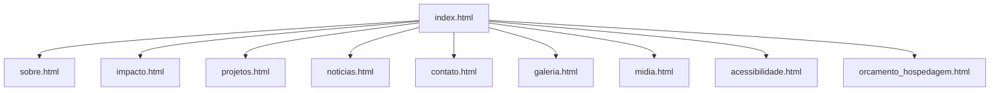

# Arquitetura, tecnologias e navegação

## 1. Visão geral

O **Movimento Sem Fome** é um projeto Front-End organizado em páginas HTML independentes, com folhas de estilo compartilhadas e um arquivo JavaScript de interação com o DOM. O projeto pode ser aberto localmente em navegador ou publicado como site estático.

**Tecnologias identificadas no código:** HTML5, CSS3, JavaScript e Font Awesome (biblioteca externa de ícones).  
**Versionamento:** Git/GitHub.  
**Publicação informada no README:** Vercel — https://trabalho-html-self.vercel.app/.

## 2. Estrutura de pastas

Estrutura dos arquivos de código **efetivamente encontrados** em 08/11/2026, acrescida desta pasta de documentação:

```text
Trabalho-HTML/
├── README.md
├── index.html
├── sobre.html
├── impacto.html
├── projetos.html
├── noticias.html
├── contato.html
├── galeria.html
├── midia.html
├── acessibilidade.html
├── orcamento_hospedagem.html
├── src/
│   ├── .gitkeep
│   ├── css/
│   │   ├── home.css
│   │   └── pages.css
│   └── js/
│       └── main.js
└── docs/                         # pasta preparada nesta entrega
    ├── README.md
    ├── escopo.md
    ├── arquitetura.md
    ├── diario_de_bordo.md
    ├── orcamento.md
    ├── testes.md
    ├── melhorias_mvp.md
    ├── uso_ia.md
    ├── processo_git.md
    ├── roteiro_apresentacao.md
    └── evidencias/
        └── README.md
```

## 3. Mapa de navegação

- **Menu principal** (identificado nas páginas examinadas): Início, Sobre, Impacto, Projetos, Notícias, Contato.
- **Navegação complementar:** Galeria, Mídia, Acessibilidade, Orçamento e hospedagem.
- **Chamadas para ação:** algumas direcionam para `contato.html`; outras usam `href="#"` ou `href=""` e exigem destino funcional para serem consideradas links operacionais.



## 4. Organização dos componentes

| Arquivo | Função observada |
| --- | --- |
| `src/css/home.css` | Base visual, cabeçalho, navegação, apresentação, cards e rodapé. |
| `src/css/pages.css` | Componentes internos, botões, formulários, tabela, multimídia, foco, ajustes de contraste e media query. |
| `src/js/main.js` | Eventos de clique nos botões de acessibilidade (`data-a`), mudança de classes CSS, ampliação/redução de texto e contraste. |
| `contato.html` | Formulário com validação HTML nativa e um manipulador `onsubmit` embutido, que impede a submissão e mostra mensagem de sucesso. |
| `midia.html` | Marcadores `video`, `audio` e `iframe` para mapa; disponibilidade dos arquivos deve ser testada online. |

## 5. Fluxo do formulário especificado para a entrega

```text
Preencher campos
      ↓
Validar nome, e-mail e mensagem
      ├── Erro → destacar campo e mostrar orientação
      └── Válido → executar lógica de envio demonstrativo
                     ↓
             apresentar resultado acessível
                     ↓
        persistir rascunho/preferência via localStorage
```

Este é o **fluxo de aceitação exigido pelo roteiro**, e não uma afirmação de que todas as etapas já foram verificadas na versão publicada. O comportamento atual está registrado em `testes.md`.

## 6. Como executar

```bash
git clone https://github.com/giuerme/Trabalho-HTML.git
cd Trabalho-HTML
```

Abrir `index.html` no navegador ou com a extensão **Live Server** do Visual Studio Code. Não há `package.json` ou rotina de build na estrutura de código consultada.

## 7. Atenções para a versão final

1. Verificar se os ícones e os arquivos de mídia existem no deploy.
2. Garantir que toda ação de formulário corresponda a um comportamento real claramente explicado.
3. Validar navegação com teclado e links de `href` vazio/placeholder.
4. Validar HTML no W3C e CSS em telas pequenas, médias e grandes.
5. Confirmar que a versão ZIP corresponda à publicada.
