# Plano de testes e evidências

## 1. Ambiente a preencher

- **URL testada:** https://trabalho-html-self.vercel.app/ 
- **Data e responsável:** [08/11/2026] - Nathan de Oliveira Tavares
- **Navegadores:** Firefox (Versão: 158.0.1)
- **Larguras-alvo:** 360 px, 768 px, 1366 px (testar e registrar)
- **Ferramentas:** DevTools, W3C Nu Validator, Lighthouse e teclado; outras se utilizadas.

## 2. Casos de teste

| ID | Procedimento | Resultado esperado | Resultado | Evidência |
| --- | --- | --- | --- | --- |
| T01 | Abrir home pela URL publicada | HTTPS, sem login e carregamento sem erro | executado | 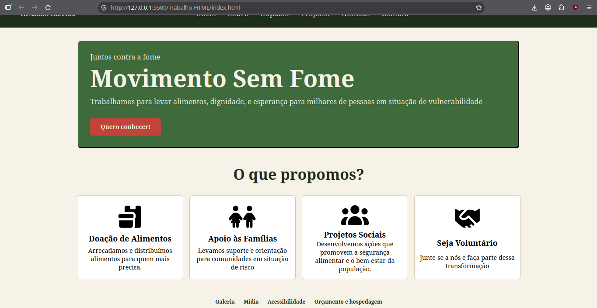 |
| T02 | Percorrer links de todas as dez páginas | Links internos chegam ao destino | executado | 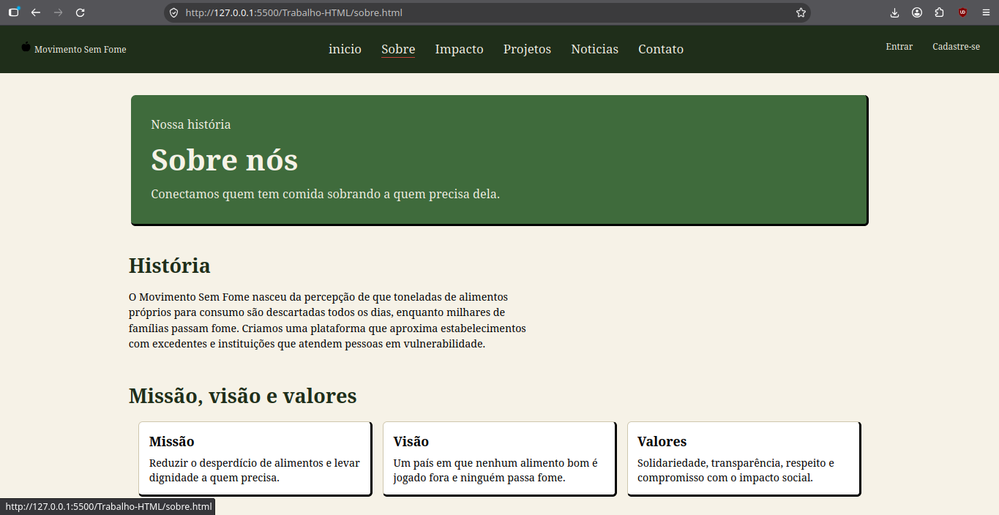 |
| T03 | Abrir em 360 px | Sem conteúdo cortado e navegação utilizável | executado parcialmente | 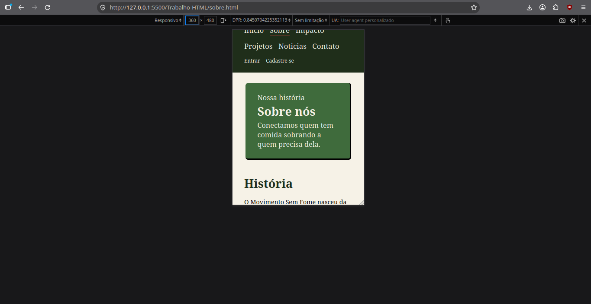 |
| T04 | Abrir em 768 px | Layout reorganizado e legível | executado | 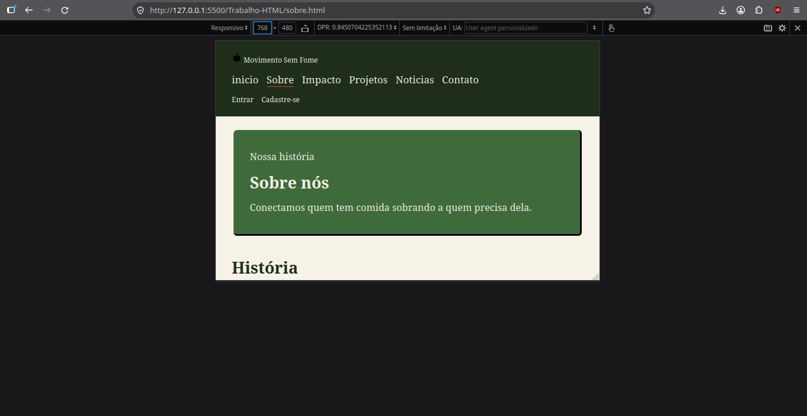 |
| T05 | Abrir em 1366 px | Layout de desktop organizado | executado | 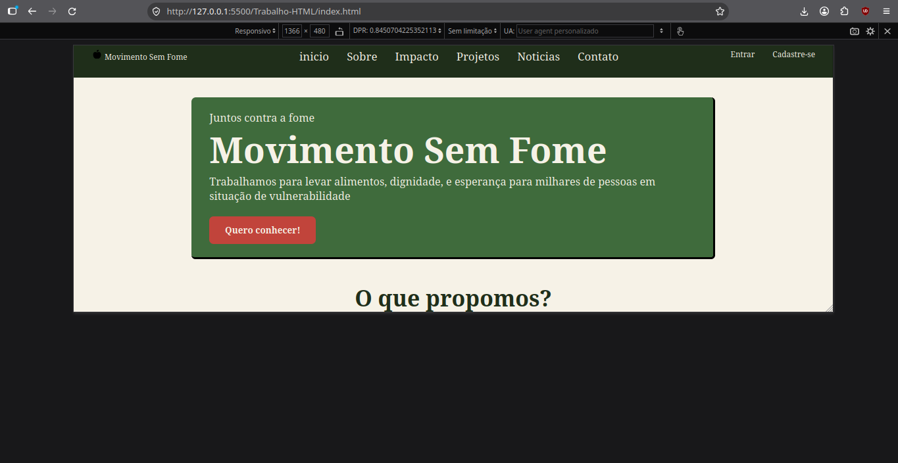 |
| T06 | Enviar formulário com campos vazios | Erros/impedimento e indicação acessível do problema | executado | 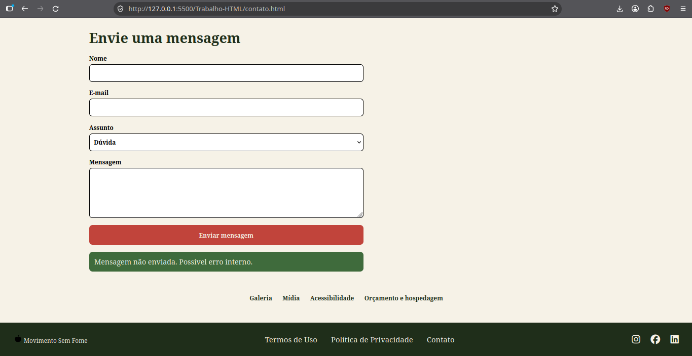 |
| T07 | Digitar e-mail inválido | Campo rejeitado, mensagem adequada e destaque | executado | 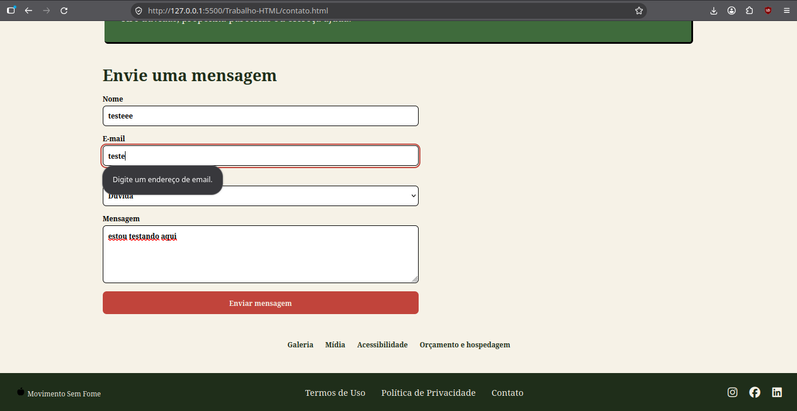|
| T08 | Enviar dados válidos | Mensagem coerente com o comportamento real | executado | 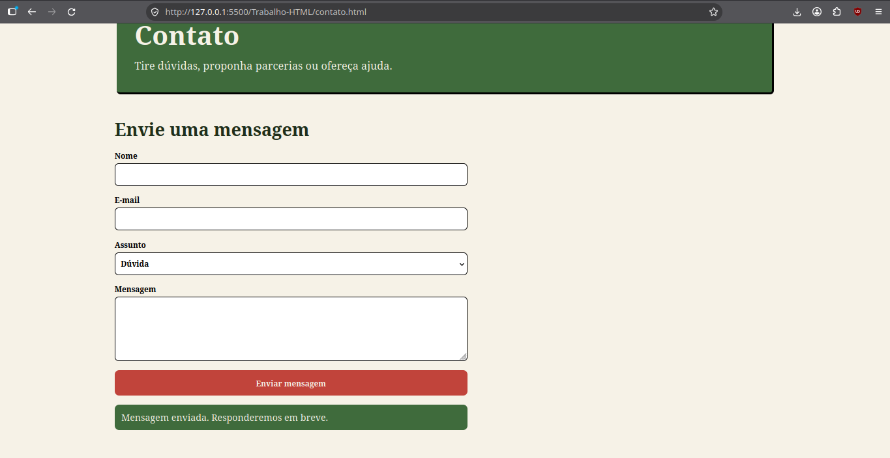 |
| T09 | Recarregar durante edição do formulário | Rascunho ou preferência definida permanece via `localStorage` | executado | 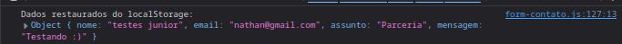 |
| T10 | Acionar alto contraste | Classe/estilo alterado sem perda de leitura | Não executado | falta comprovar |
| T11 | Acionar aumentar/diminuir texto | Texto altera e mantém legibilidade | Não executado | falta comprovar |
| T12 | Navegar com Tab e Enter | Foco visível, ordem lógica e controles acessíveis | executado | 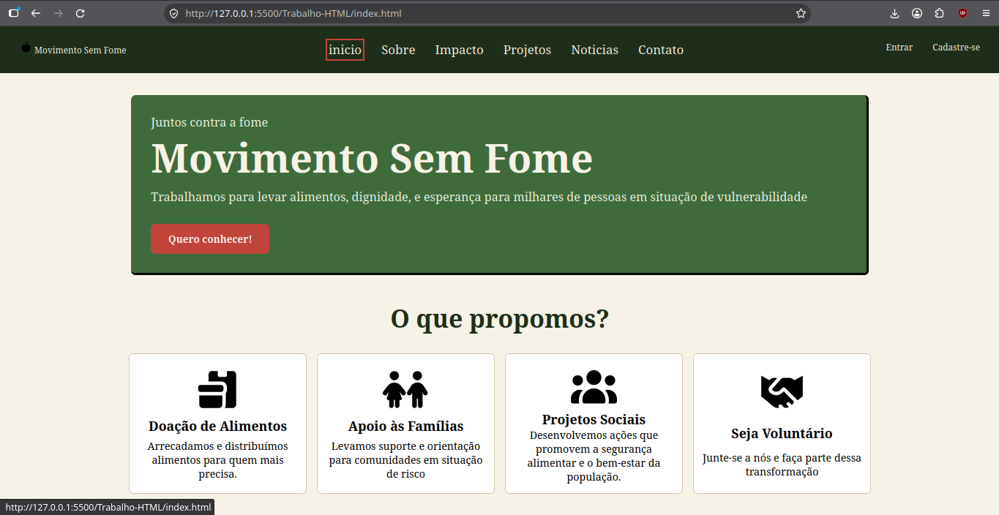 |
| T13 | Validar `index.html` no W3C | Zero erros | executado | 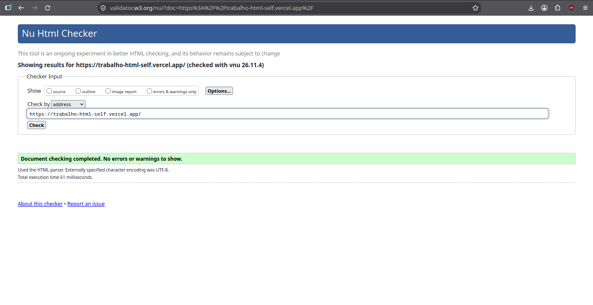 |
| T14 | Validar as outras nove páginas no W3C | Zero erros em cada uma | executado | Todas as outras noves páginas apresentaram um comportamento normal ao validar, sem erros |
| T15 | Executar auditoria Lighthouse | Relatório registrado e problemas analisados | Não executado | sem comprovação |
| T16 | Examinar imagens/ícones | Carregamento e `alt` adequados | executado | 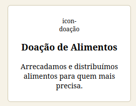 |
| T17 | Reproduzir vídeo em `midia.html` | Vídeo reproduz normalmente | executado | 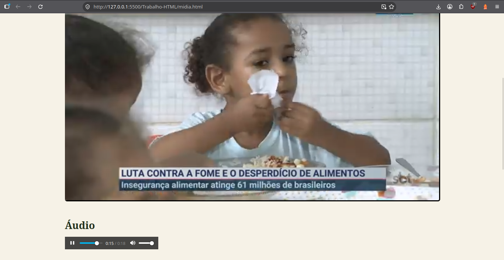 |
| T18 | Reproduzir áudio em `midia.html` | Áudio reproduz normalmente | Executado |  |
| T19 | Carregar mapa incorporado | `iframe` aparece e é navegável | executado | 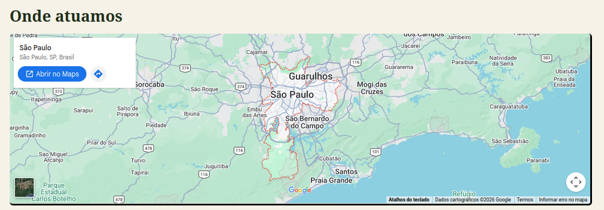 |
| T20 | Abrir galeria | Galeria apresenta conteúdo visual pertinente | executado | 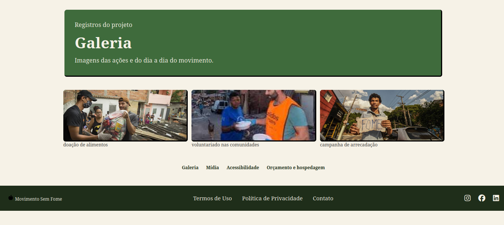 |
| T21 | Inspecionar console do navegador | Sem erros de JS e de carregamento críticos | executado | 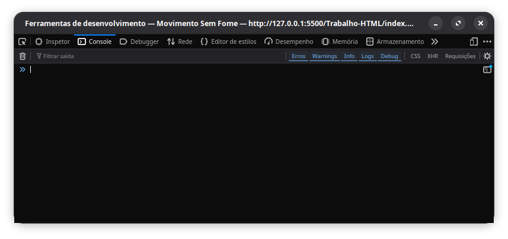 |

## 3. Validação HTML — registro por página

**Validador:** https://validator.w3.org/nu/  
**Critério exigido pela rubrica:** zero erros em todas as páginas.

| Página | Data | Nº de erros | Evidência |
| --- | --- | --- | --- |
| `index.html` | 08/11/2026 | 0 | Testes realizados e aprovados |
| `sobre.html` | 08/11/2026 | 0 | Testes realizados e aprovados |
| `impacto.html` | 08/11/2026 | 0 | Testes realizados e aprovados |
| `projetos.html` | 08/11/2026 | 0 | Testes realizados e aprovados |
| `noticias.html` | 08/11/2026 | 0 | Testes realizados e aprovados |
| `contato.html` | 08/11/2026 | 0 | Testes realizados e aprovados |
| `galeria.html` | 08/11/2026 | 0 | Testes realizados e aprovados |
| `midia.html` | 08/11/2026 | 0 | Testes realizados e aprovados |
| `acessibilidade.html` | 08/11/2026 | 0 | Testes realizados e aprovados |
| `orcamento_hospedagem.html` | 08/11/2026 | 0 | Testes realizados e aprovados |

## 4. Acessibilidade e critérios objetivos

- [x] Idioma declarado `lang="pt-BR"` nas páginas (a capitalização pode ser normalizada).
- [x] `alt` descritivo ou vazio para imagens estritamente decorativas.
- [x] Contraste de texto compatível com WCAG AA nos principais componentes e estados.
- [x] Foco visível e navegação apenas com teclado.
- [x] Campos com rótulos, erros legíveis e, quando necessário, atributos ARIA.
- [x] Sem perda de conteúdo na ampliação de texto e em telas pequenas.
- [x] Resultados da auditoria Lighthouse anexados sem confundir pontuação com certificação WCAG.
